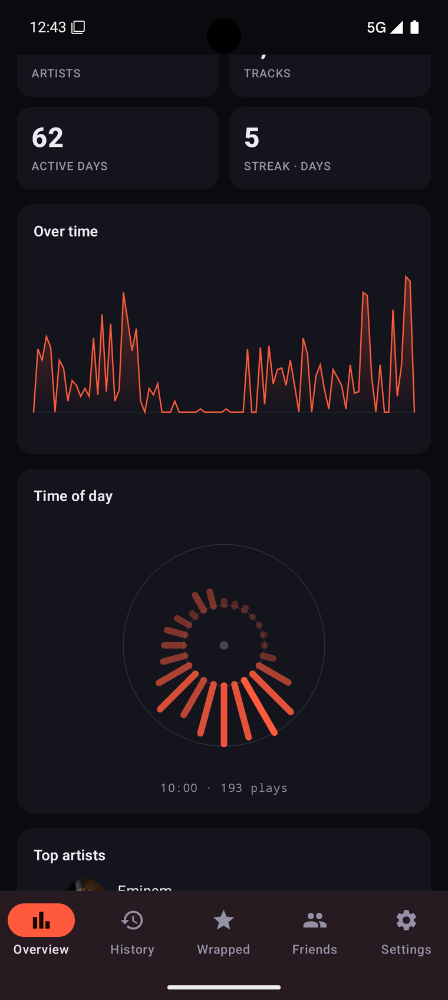
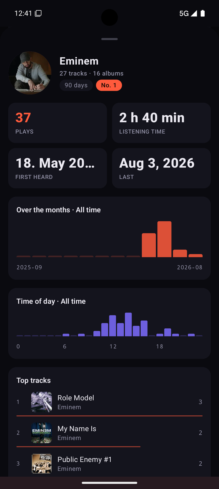
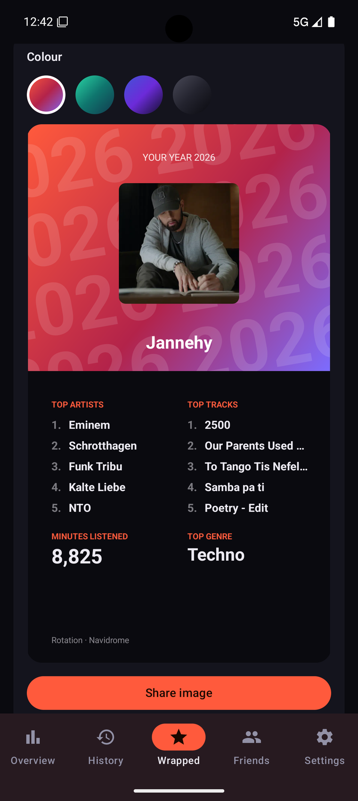
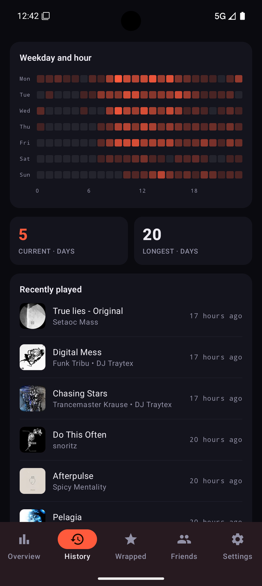

# Rotation for Android

A native Jetpack Compose client for a [Rotation](https://github.com/Jannehy/rotation)
server — your listening year, from your pocket.

<p align="center">
  <a href="https://play.google.com/store/apps/details?id=org.rotationmusic.app"></a>
</p>

<p align="center">
  
  
  
  
</p>

## What it does

| Screen | What you get |
|---|---|
| **Overview** | Top artists, tracks, albums and genres for 7, 30 or 90 days, this year or all time — with rank, plays and hours, and your discoveries of the period |
| **Detail** | Every artist, album and track with its own history and a 30-second preview from your library |
| **History** | A weekday-by-hour heatmap and what you played last |
| **Recap** | Your year as a full-screen story: it advances by itself, holds when you hold it, plays music from your library, and asks you to guess before it tells |
| **Friends** | Other users of the same Navidrome and the artists you have in common |
| **Settings** | Server and account, who may find you, the accent colour, and the recap's season options including the December reminder |

English and German, following the device language, with six accent colours.

## What you need

- **Android 8** or newer
- A **Rotation server** you can reach from the device — on your home network or
  through a VPN such as Tailscale or WireGuard
- A **Navidrome account** on the server behind it. Rotation has no user
  database of its own.

No server to hand? Tap **Try the demo** on the sign-in screen: an invented
listening year, complete with recap, entirely on the device.

## Installing

From [Google Play](https://play.google.com/store/apps/details?id=org.rotationmusic.app) — updates then arrive by themselves. Or take the
APK from the [latest release](../../releases/latest), open it and allow the
install once; later APKs install straight over the previous version.

## Connecting

On first launch, enter the address of your server:

| Typed | Used |
|---|---|
| `192.168.1.20` | `http://192.168.1.20:8770` |
| `192.168.1.20:9000` | that port instead of the default |
| `rotation.tail1234.ts.net` | over Tailscale, with the tunnel up |
| `https://rotation.example.com` | taken as typed, port 443 |

A bare host gets `http://` and Rotation's default port `8770`; anything more
explicit is used as you typed it, path prefix included. Plain HTTP to private
addresses is permitted by `res/xml/network_security_config.xml` — that is how a
self-hosted server on the local network is normally reached. Behind an HTTPS
reverse proxy, enter the full `https://` URL.

Sign in with your Navidrome account. The session survives restarts.

## Building from source

```bash
./gradlew assembleRelease      # APK
./gradlew bundleRelease        # AAB, for Play
```

Needs **JDK 17** and the Android SDK; everything else the Gradle wrapper
fetches. Signing is read from `keystore.properties` in the project root when
that file exists, so the release build also works on a machine without the key:

```properties
storeFile=rotation-release.jks
storePassword=…
keyAlias=rotation
keyPassword=…
```

Neither the keystore nor that file belongs in the repository — both are in
`.gitignore`. Keep a backup somewhere safe: Play ties the app to that key
forever, and there is no way to sign an update without it.

## Notes

- **The recap button** on the overview appears between 1 December and 31
  January, the way a yearly recap should. The Recap tab itself is there all
  year; its setting decides whether the button on that page shows outside the
  season.
- **The reminder** on 1 December is an inexact `AlarmManager` alarm, re-armed
  each year when it fires. No push service is involved.
- **Previews** are fetched with the app's own HTTP client — `MediaPlayer` keeps
  its own network stack and carries no session cookie — as a byte range out of
  the middle of the track, and played from the cache.

## Licence

[MIT](LICENSE)
